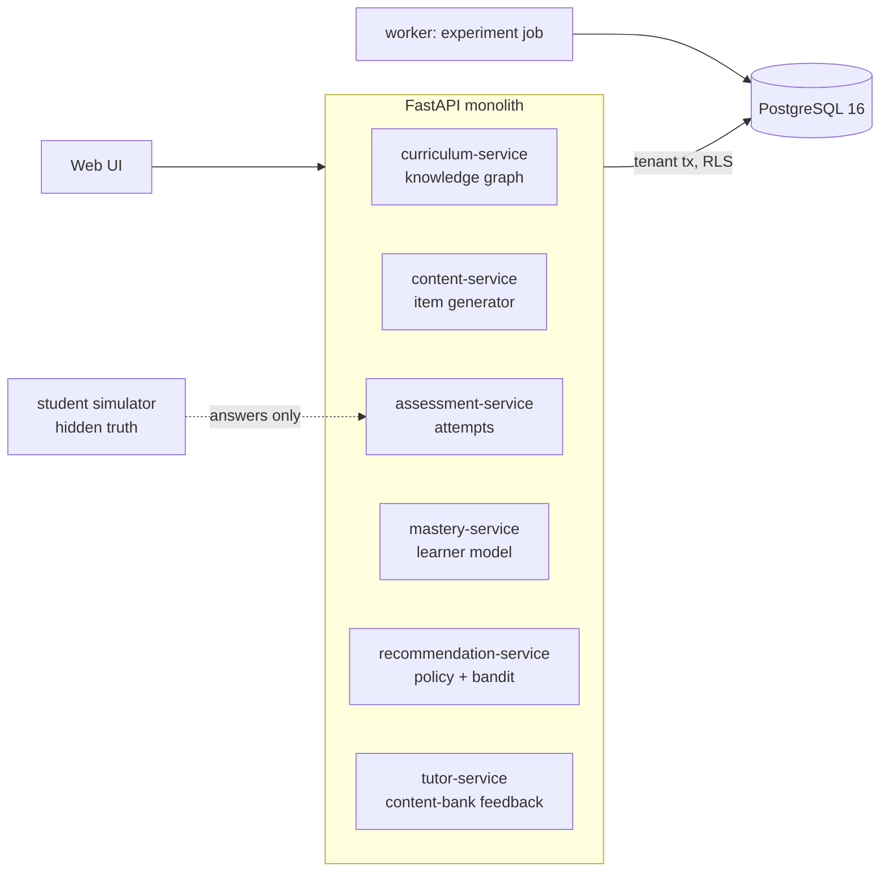

# Adaptive Education Knowledge Graph & Tutor Engine

A tutor that keeps a probability of mastery for every concept in a course, notices when a learner's wrong answers follow a
pattern (a misconception), and chooses the next activity from that picture: fix the misconception first, review what is about to
be forgotten, otherwise teach the concept the learner is ready for.

Built from blueprint 7 of "Advanced Project Blueprints, Volume II" as a **vertical slice**: the demo scenario end to end, with the
platform parts real and the rest listed under [Not built](#not-built-and-why).

**The learners are simulated, and they learn and forget in the way the tutor's model assumes. This shows the engine working in that world; it is not evidence that it helps real children. The tutor writes no text of its own: every hint is a line from the course content.**

## Run it

```bash
docker compose up --build        # migrates, seeds, serves http://localhost:8207/ui/ with one worker
docker compose run --rm test     # 48 tests against a throwaway database
```

Open http://localhost:8207/ui/ and press **Run all steps**, or `make bootstrap demo`. API docs at `/docs`.
Demo tokens (local only): `school-admin-demo`, `school-teacher-demo`, `school-student-demo`. Run `make reset` before a second demo run.

## The demo, step by step

1. A pre-algebra course: 18 concepts, 26 prerequisite links, 4 modelled misconceptions, and one simulated student, S-001.
2. A placement quiz, one item per concept. S-001 gets 7 of 18 right, and 6 of the wrong answers are exactly what "minus a negative means minus" produces. The tutor's belief in that misconception goes to 99%, and its trust falls only in the six concepts that need the rule; coordinates, percent and area are untouched.
3. One answer up close: *Solve x + (-2) = 7*, answered 5. The tutor names the rule, gives a contrast example from the course content, cites its sources, and does not give the answer away on a first try.
4. Recommended next: not the next chapter but a remediation item on subtracting integers, "because 6 concepts depend on fixing it". Five such items on day 1 bring the belief down to 20%, and to 1% by day 4.
5. Sessions every other day to day 14, mixing new learning with reviews scheduled by each concept's half-life. S-001 really masters 13 concepts (from 8); the tutor believes 10.
6. A second wrong try with an answer that matches no misconception gets the plain rule and the answer, with no diagnosis. A non-numeric answer is refused.
7. The experiment: 300 simulated students taught two ways. Adaptive: 10.6 concepts mastered. Fixed sequence with regular review: 4.4. Difference 6.2 (95% interval 5.7 to 6.6), 278 students ahead and 15 behind. Then the audit log.

## Architecture



| Piece | How it works |
|---|---|
| Items | Parametric templates per concept. The answer is computed; for four item kinds it is recomputed independently by parsing the item's own text, and an item that disagrees is never served. Each item also carries the wrong answer every relevant misconception would produce ("buggy rules"). |
| Mastery | Bayesian Knowledge Tracing per concept: a probability updated by each answer, then nudged up by the chance of learning from the practice (less if prerequisites are not in place). |
| Misconceptions | A second probability per misconception, updated by Bayes' rule on whether the answer was exactly the buggy one, correct, or something else. Clamped to 1% to 99% so it can always be revised. |
| Trusted mastery | A concept's mastery multiplied down by any suspected misconception it depends on. This is what gates "ready for the next concept". |
| Forgetting | Recall = trusted mastery x 0.5^(days since practice / half-life). The half-life starts at 6 days and doubles with each correct answer at least a day after the last. |
| Policy | 1. Remediate a misconception believed at 60% or more. 2. Review any concept whose recall has fallen under 85%. 3. Teach the ready concept with the most to gain, weighted by how many later concepts need it. |
| Presentation | Worked example, plain practice or hint first: chosen by Thompson sampling, rewarded by whether the *next* answer on that concept is right. |
| Tutor feedback | Lines from the content bank only, with source ids. Hint first; the answer is shown from the second wrong try. |
| Platform | Row-level security per school, Postgres job queue, Idempotency-Key replay, hash-chained audit log, `/metrics`. |

## Data model

`migrations/002_tutor.sql` follows the blueprint (concepts, concept_edges, learners, attempts, mastery, interventions); additions are
marked `(+)`: items, misconceptions, the spacing columns on mastery, and the simulator's hidden state for demo learners.
Learners carry an external id only.

## API

| Method | Endpoint | Purpose |
|---|---|---|
| POST | `/v1/attempts` | Record an answer; update mastery and misconception beliefs |
| GET | `/v1/learners/{id}/mastery` | Per concept: mastery, trusted mastery, recall today, review due; suspected misconceptions |
| POST | `/v1/recommendations/next` | Next activity, the item, and the reason |
| POST | `/v1/tutor/respond` | Feedback from the content bank, with sources |
| GET | `/v1/courses/{id}/knowledge-graph` | Concepts and prerequisites, optionally coloured for one learner |
| POST | `/v1/content/generate` | Generate and validate practice items |
| POST | `/v1/simulations/learners/{id}/session` | (+) The simulated learner works a session |
| POST | `/v1/experiments/adaptive-vs-fixed` | (+) 202 + job: teach simulated students two ways |
| POST | `/v1/scenarios/classroom` · GET `/v1/learners` | (+) Load the course; list learners |

Contract: [`docs/openapi.json`](docs/openapi.json).

## Measured

[`docs/evaluation.md`](docs/evaluation.md) (`python -m tu.evaluate`, 400 simulated students per arm) and [`docs/performance.md`](docs/performance.md).

| Component | Result | Baseline |
|---|---|---|
| Concepts mastered after 30 days (of 18) | 10.65 | fixed sequence with review: 4.41 |
| Same, two weeks later with no practice | 7.78 | 2.64 |
| Without the presentation bandit | 9.84 | |
| Predicting the next answer (AUC) | 0.793 | student's running share correct: 0.547 |
| Spotting misconceptions from the placement quiz (precision / recall) | 1.000 / 0.730 | any wrong answer on a related concept: 0.292 / 1.000 |
| Presentation chosen, new concept / practised concept | worked example 93% / practice 89% (both the simulator's true best) | |

## The hardest tradeoff

How much to believe my own experiment. Six extra concepts in a month is a large effect, and most of it comes from one mechanism:
in the simulator a held misconception blocks every concept that depends on it, the tutor targets misconceptions and the fixed
sequence does not. That mechanism is plausible, and it is also something I wrote into both the simulator and the tutor. The tutor's
numbers differ from the simulator's (it assumes slower learning and slower forgetting than is true, and it is visibly miscalibrated
in the middle of the range), but the *shape* of the model is shared, which is exactly the advantage a real tutor would not have. So
the experiment is reported as a check that the policy does what it was designed to do, with the caveat attached to the result
itself in the API. The honest test is real learner logs (ASSISTments, EdNet), where the fixed-parameter model would first have to
earn its 0.79.

## Threat model (summary)

| Threat | Mitigation here | Gap |
|---|---|---|
| One school reading another's learners | Row-level security on every table; tested with a second school whose reset touches only its own rows | Within a school, a student token is not tied to one learner |
| Exposing children's data | Learners have an external id only; no names, no free text is stored | Attempt histories are still personal data and are not encrypted at field level |
| A tutor that says something wrong or inappropriate | No generated text: feedback is selected from a fixed content bank and carries its source ids; answers must be whole numbers | The content bank is small and written by one person |
| Wrongly labelling a learner | A misconception is suspected only when the answer is exactly the buggy one, repeatedly; the belief can always fall again (tested) | No teacher override |
| A retried answer counted twice | Idempotency-Key replay (tested) | |

## Not built, and why

- **Real learner data** (ASSISTments, EdNet): simulated students stand in, with the limits described above.
- **A language-model tutor, free-text answers, a misconception classifier on text**: answers are whole numbers and feedback is chosen from the content bank.
- **Fitted parameters, Item Response Theory, deep knowledge tracing**: learn, slip, guess and half-life are assumed constants; item difficulty is not modelled.
- **A real clock**: the day of the course is passed in, so spacing can be demonstrated in one run.
- **Teacher tools, rostering, LTI / LMS integration, accessibility review**: not started.
- **Kafka, Redis, OpenTelemetry, Grafana, MLflow, Terraform, CI, SSO, a Next.js front end**: not needed to prove the slice; no cloud account used.

## Commercial sketch

Buyer: schools, tutoring providers, certification bodies. Pricing shape from the blueprint: per active learner, site licences, a
white-label tutoring API, premium analytics.

## Layout

```
core/        platform kit: db + RLS, jobs, audit chain, HTTP, scenario runner, load test
tu/          curriculum (concepts, item generators, content bank), engine (learner model, policy), world (simulated students, experiment), api, seed, evaluate
migrations/  forward-only SQL          web/   UI, scenario.json, demo.json (recorded run)
tests/       48 tests                  docs/  evaluation.md, performance.md, openapi.json
```
